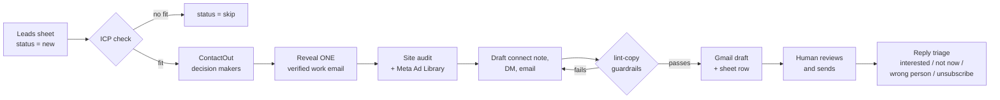

# Claude Outbound Agent

An AI outbound agent for **Adcelerate Media**, a performance-marketing agency for
health and wellness businesses (clinics and supplement brands). It is built on
**Claude Code**: a skill holds the agent's instructions, small Node scripts do the
deterministic work, and Claude Code's Gmail and Google Sheets connectors are its hands.

It replaces the slowest part of outbound: finding the right person, looking at
their website, and writing a first message that is specific enough to get a reply.

> **Case study page:** https://claude-outbound-agent.vercel.app

## What it does



1. **Reads** new rows from a Google Sheet (company, website, segment).
2. **Qualifies** each lead against the ICP in [`config/icp.md`](config/icp.md).
3. **Finds the decision maker** with the ContactOut Decision Makers API, then
   reveals a work email for exactly one person, so credits are spent once per company.
4. **Audits the funnel**: booking vendor, tracking pixels, visible offers, platform,
   and live Meta ads for brands.
5. **Drafts** a LinkedIn connect note, a follow-up DM and an email in the sender's voice
   ([`config/voice.md`](config/voice.md)), hooked on one finding.
6. **Checks every draft** with [`scripts/lint-copy.mjs`](scripts/lint-copy.mjs) and
   rewrites until it passes.
7. **Saves** the email as a Gmail draft and the LinkedIn texts in the sheet.
8. **Triages replies** and drafts a booking-link answer for interested prospects.

## Design decisions

**A human sends every message.** The agent writes drafts only. LinkedIn messages are
pasted and sent by hand: automating LinkedIn sends breaks its terms and puts the
sender's profile at risk.

**Measured vs. unmeasured findings.** The audit tags each finding `measured: true`
(seen in the page, like a Boulevard booking widget) or `measured: false` (an absence
in static HTML, like "no Meta Pixel found"). Site builders inject tags at runtime,
so absences can be wrong. Only measured findings may appear in a message. One false
"you don't have online booking" kills the conversation.

**Guardrails in code, not just in the prompt.** `lint-copy.mjs` rejects em dashes,
guarantee and multiplier claims, filler phrases, claims that something is missing,
inaccurate credentials, and drafts over each channel's length limit.

**Credit discipline.** `decision-makers` runs without `reveal_info`, so it only costs
search credits. Email credits are spent on the single chosen person.

**Proof is whitelisted.** The agent may only cite results listed in
[`config/proof.md`](config/proof.md). An empty file means no results claims.

**Time saved is logged, not estimated.** [`scripts/timelog.mjs`](scripts/timelog.mjs)
records minutes per lead by hand (baseline) and with the agent, and reports hours saved.

## Project layout

```
.claude/skills/outbound/SKILL.md   the agent: steps, modes, rules
config/
  voice.md          sender voice and hard rules
  icp.md            who to contact and which person to pick
  proof.md          the only results the agent may cite
  sheet-schema.md   Leads sheet columns and status flow
scripts/
  contactout.mjs    ContactOut API CLI (decision-makers, contact, enrich, stats)
  audit.mjs         website funnel audit with measured/unmeasured tagging
  lint-copy.mjs     outreach guardrail check
  timelog.mjs       time-saved log and report
```

No dependencies. Node 18+.

## Setup

1. `cp .env.example .env` and fill in `CONTACTOUT_API_KEY`, `LEADS_SHEET_ID`, `CAL_LINK`.
2. Create the sheet with the headers in [`config/sheet-schema.md`](config/sheet-schema.md).
3. Fill the two placeholders in `config/voice.md`.
4. In Claude Code, connect Gmail and Google Sheets, open this folder, and run `/outbound`.
5. To run it every weekday morning, create a Claude Code scheduled task with the prompt `/outbound`.

Individual tools:

```bash
node scripts/audit.mjs example-clinic.com
node scripts/contactout.mjs decision-makers example-clinic.com
node scripts/lint-copy.mjs connect draft.txt
node scripts/timelog.mjs report 7
```

## Status

Built November 2026. Not yet run on live leads; the time-saved numbers will be added
here from `timelog.mjs` once there is a full week of baseline and agent data.

## License

MIT
